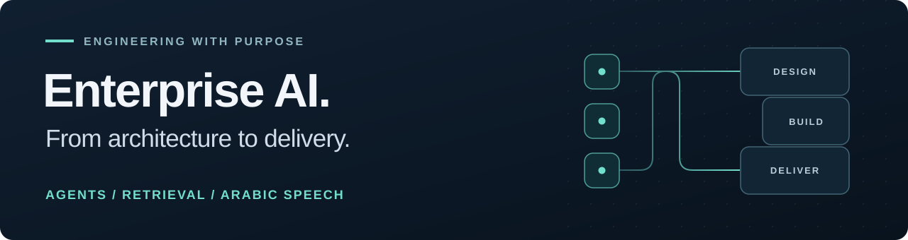

  

<h1 align="center">Mohamed Salama</h1>

  <strong>AI Technical Lead · Generative AI · RAG · Arabic Speech</strong> 
  Riyadh, Saudi Arabia · Arabic & English

  <a href="https://www.linkedin.com/in/mohamedsalama1/"><strong>LinkedIn</strong></a> &nbsp; / &nbsp;
  <a href="mailto:m.salama422@gmail.com"><strong>Get in touch</strong></a> &nbsp; / &nbsp;
  <a href="https://huggingface.co/Salama1429"><strong>Models on Hugging Face</strong></a>

---

I turn business requirements into AI systems that teams can deploy and operate. My experience spans **government and banking**, combining hands-on engineering with solution architecture, model evaluation, and technical leadership.

Currently **AI Technical Lead at Elm**, focused on on-premises agents, retrieval, and speech AI. I work across engineering, platform, cybersecurity, and business teams to take systems from design through release readiness.

## Selected delivery experience

- **Government AI at Elm** — Lead architecture and development of the on-premises Absher Smart Assistant, combining LLM reasoning with deterministic workflows, input validation, and controlled API execution.
- **Banking and speech AI at Future Look ITC** — Developed intent-recognition models and led implementation of a production banking voice agent. Delivered an on-premises RAG chatbot and developed Saudi-dialect speech recognition.
- **Engineering leadership** — Evaluate models and vendors, guide architecture decisions, and mentor engineers. Earlier engineering and operations roles included managing teams of up to **70 staff**.

## What I bring to a team

| Area | Engineering focus |
| :--- | :--- |
| **Reliable AI agents** | Controlled tool execution, deterministic workflows, and evaluation of routing, extraction, and command generation. |
| **Retrieval systems** | Hybrid dense/BM25 search, reranking, and domain-specific question answering. |
| **Production delivery** | On-premises architecture, GPU capacity planning, load testing, and inference optimization. |
| **Arabic speech** | Voice agents, ASR, TTS, dialect identification, and speech analytics. |

## Products & public projects

My production experience includes private systems. Explore a public product and selected public prototypes below.

<table>
<tr>
<td width="50%" valign="top">
<h3>FasihTTS</h3>

<strong>Arabic speech product</strong>

Text-to-speech for Arabic dialect workflows, with long-form generation and a REST API.

<a href="https://www.fasihtts.com/en/home">Explore the product →</a>

</td>
<td width="50%" valign="top">
<h3>Kalemat-Tech</h3>

<strong>Arabic speech recognition</strong>

Whisper Small fine-tuning with augmented Common Voice data, published training details, and model weights.

<a href="https://github.com/Salama1429/Kalemat-Tech-Arabic-STT-ASR-MSA">Repository →</a> &nbsp; <a href="https://huggingface.co/Salama1429/KalemaTech-Arabic-STT-ASR-based-on-Whisper-Small">Model →</a>

</td>
</tr>
<tr>
<td width="50%" valign="top">
<h3>PilgrimProAI</h3>

<strong>Conversational avatar prototype</strong>

A hackathon project combining LLMs, speech recognition, speech synthesis, and lip-sync.

<a href="https://github.com/Salama1429/PilgrimProAI">Repository →</a> &nbsp; <a href="https://lablab.me/event/virtual-ai-hackathon/pilgrimpro-ai/pilgrimproai">Project story →</a>

</td>
<td width="50%" valign="top">
<h3>Pharmax</h3>

<strong>LLM application prototype</strong>

A healthcare hackathon project exploring speech input and language-model integration.

<a href="https://github.com/Salama1429/pharmax">Repository →</a> &nbsp; <a href="https://lablab.me/event/langchain-online-ai-hackathon/medisoft-health/pharma-x">Project story →</a>

</td>
</tr>
</table>

## Tools I work with

**Build:** Python · SQL · API integration  
**Retrieve & orchestrate:** Qdrant · Hybrid search · Reranking · Rasa Pro (CALM)  
**Deploy & operate:** vLLM · OpenShift · Kafka · GPU capacity planning  
**Train & explore:** Hugging Face Transformers · Whisper · SpeechT5

## AWS certifications

- **AWS Certified Generative AI Developer – Professional** · September 2026
- **AWS Certified Solutions Architect – Associate** · September 2026

---

### Let's build useful AI.

For **AI technical leadership, solution architecture, or senior engineering opportunities**, connect on [LinkedIn](https://www.linkedin.com/in/mohamedsalama1/) or [email me](mailto:m.salama422@gmail.com).
