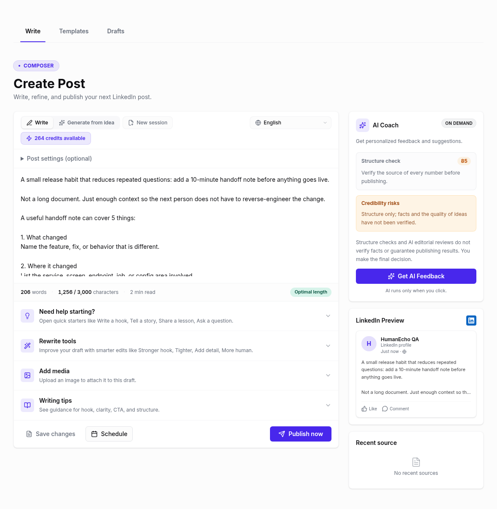
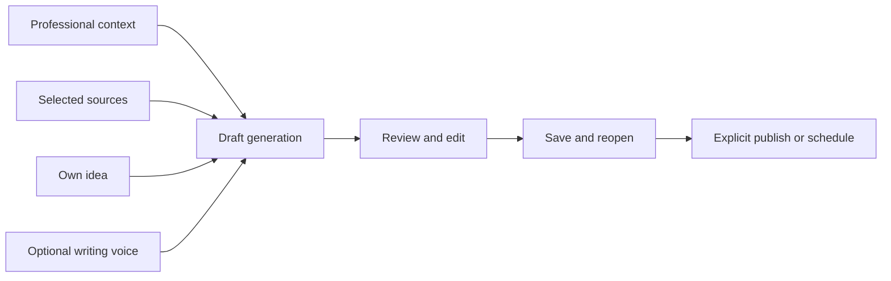
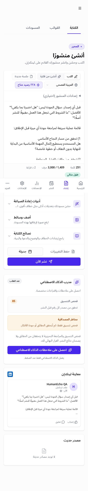

# HumanEcho

### From professional expertise to a reviewed bilingual draft

[Live product](https://www.humanecho.ai/en) · [Arabic experience](https://www.humanecho.ai/ar) · [Mohamed Salama](https://github.com/Salama1429)

HumanEcho is a LinkedIn drafting SaaS for professionals who want to publish useful content without starting from a blank page. It brings three starting points into one workflow: suggestions based on professional context, selected source material, and the author's own idea.

*Screenshots show actual product screens with synthetic QA content. They contain no customer drafts or login credentials.*

## The product decision

A useful first draft should be possible before connecting an inbox or LinkedIn account. HumanEcho keeps those integrations and writing samples optional during onboarding. The author can generate, edit, save, leave, and reopen a draft before choosing whether to publish.

The Arabic experience extends beyond translated labels. Navigation mirrors for right-to-left reading, Arabic fonts load, and the draft's reading direction follows its content independently of the interface language.

## How the system fits together

| Engineering choice | User benefit |
| :--- | :--- |
| Next.js and TypeScript | Shared onboarding, editor, templates and marketing experience |
| Supabase Auth, PostgreSQL and row-level security | Authenticated workspace access enforced on the server |
| Bounded AI calls and explicit credit accounting | Clear costs, controlled retries and refunds on failed operations |
| Voice profiles with optional example analysis | Reusable writing guidance without requiring samples to begin |
| Separate persistence and external publishing | Saving a draft leaves publishing under the author's control |
| Stripe and automatic GitHub/Vercel releases | Visible subscription terms and traceable delivery |

## Reliability work grounded in the customer journey

An interrupted onboarding request could record completion before all required setup succeeded. The improved sequence records completion last and reuses scoped identifiers on retries. That allows recovery without duplicate styles or welcome-credit grants. It remains a retry-safe sequence rather than a single database transaction.

Live model testing then found a different boundary failure: a quality-review schema passed local Zod validation but was rejected by the provider's strict JSON-schema contract. The fix separates required transport fields from legacy normalization defaults. Regression checks inspect the AI SDK's actual generated JSON schema, including nested dimensions and judge scores.

The same customer review verified credit refunds on failed AI checks, retained profile edits after a network failure, complete account exports, valid scheduling timezones, and keyboard focus after confirmation dialogs. A passing build was followed by checks of browser behavior, API outcomes and persisted data.

## What was verified

The October 10, 2026 review used a real production magic-link account and synthetic content. It exercised English and Arabic generation with the live model, writing-sample analysis, save/reopen, dismissal, duplication, templates, account preferences, avatar upload and checkout entry. Forty authenticated page/viewport combinations passed the layout and locale-direction checks; the core onboarding/editor screens were also checked at 320, 390, 768, 1280 and 1440 pixels where applicable.

Large-library, pagination, low-credit and network-failure states used explicitly identified fixtures. CI includes two English/Arabic first-draft journeys against disposable Supabase Auth/PostgreSQL, with paid generation and cookie transport replaced. These checks complement real production browser/model testing.

The final local suite passed **673 unit/integration tests**; the production dependency audit found **zero known vulnerabilities** on the review date. Releases are followed through CI and the automatic Vercel deployment, then checked on the live site.

These are dated engineering observations. They do not establish revenue growth, customer adoption, higher engagement, or a measured improvement in voice matching.

<strong>View the Arabic mobile editor</strong>

## Practical limits and next measures

Real Gmail sync and LinkedIn delivery need connected provider accounts. Paid checkout, subscription lifecycle, multi-identity production authorization and assistive-technology testing require separate evidence. AI reviews are editorial guidance; they do not verify facts or guarantee publishing results.

The product measures to track next are time to the first useful saved draft, returning use, generation failure rate and paid conversion. The application source is private; this page makes the product decisions, engineering approach and verified behavior reviewable without publishing private code.

---

For AI technical leadership, solution architecture or senior engineering opportunities: [LinkedIn](https://www.linkedin.com/in/mohamedsalama1/) · [Email](mailto:m.salama422@gmail.com).
